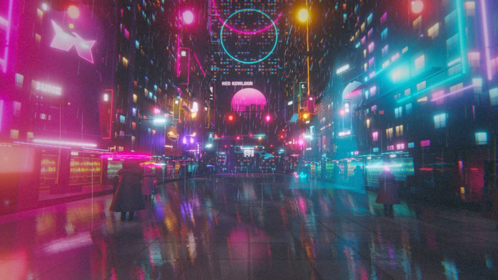
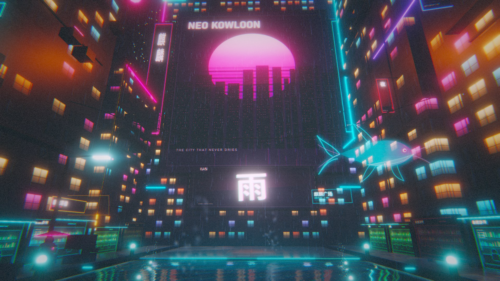
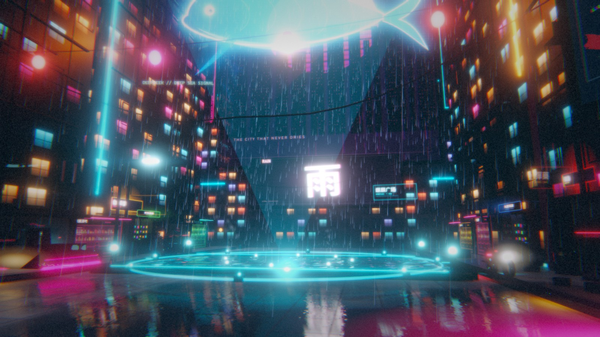
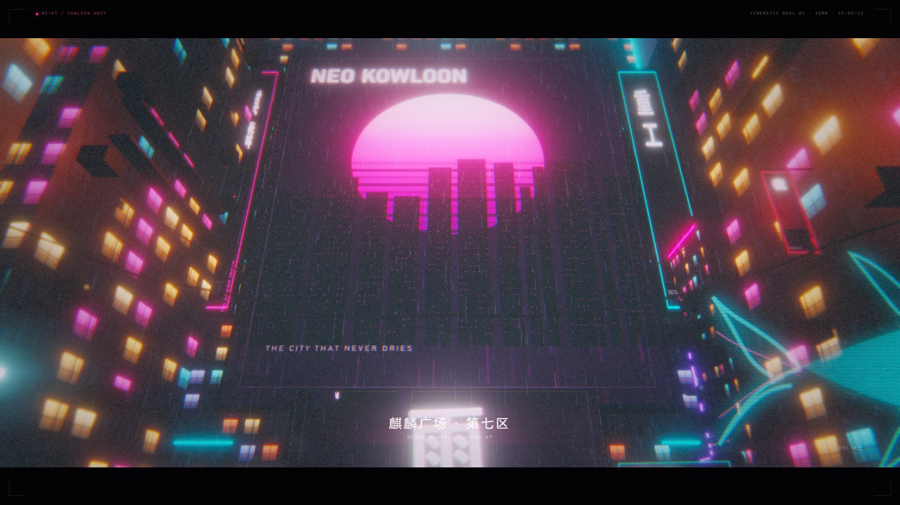
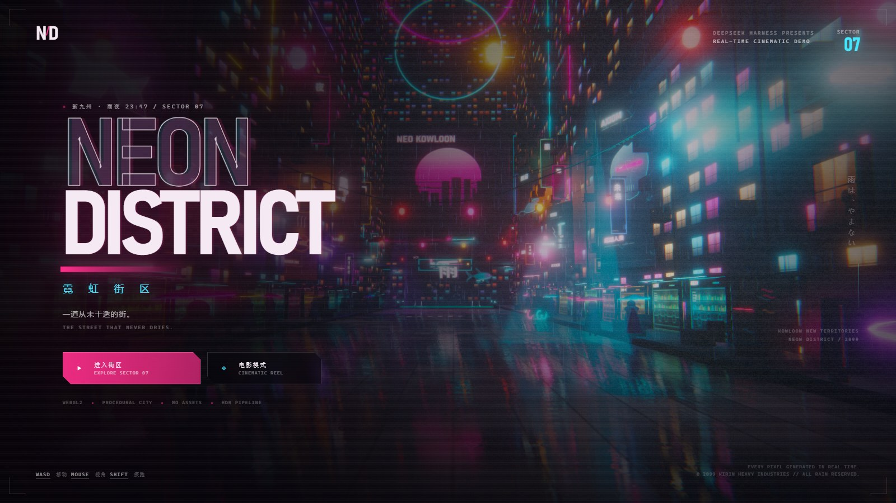
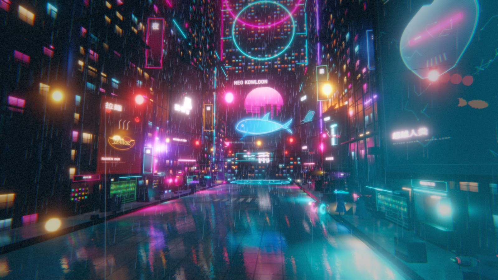
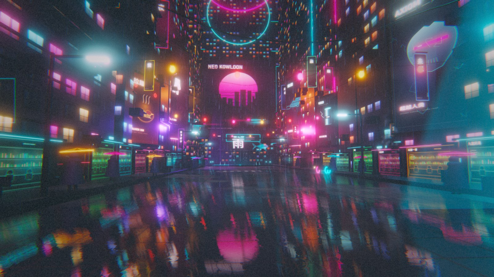
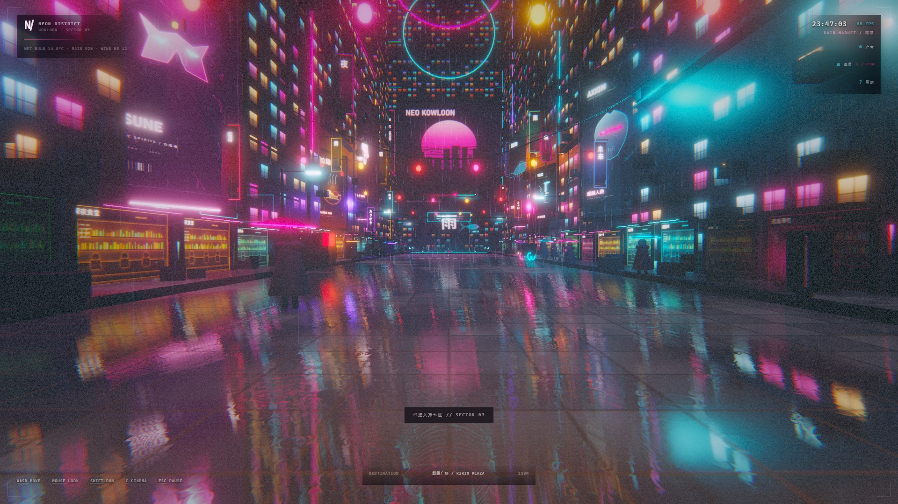
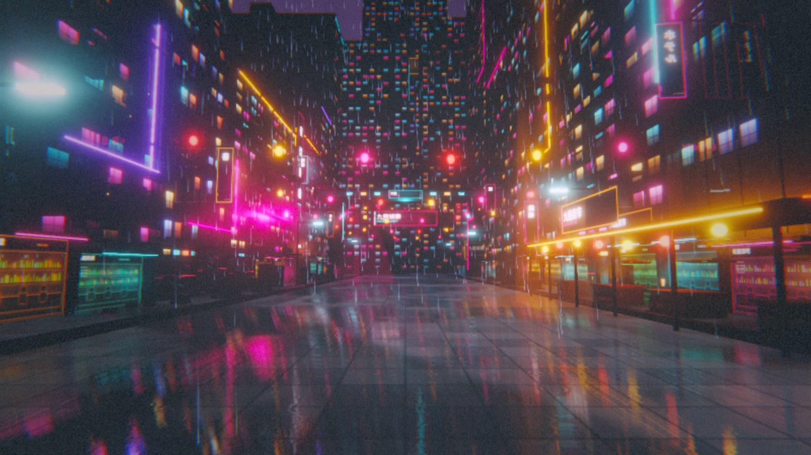

# Neon District / 霓虹街区

**by DeepSeek-V4.1flash-1017🐳**

**DSH-PTC**

**1 scene · 100% procedural · 0 assets · single-file build 0.93 MB**

[**Live preview**](https://cl0ud-99.github.io/neon-district/) — runs in the browser, nothing to install.

A real-time cyberpunk rain street built entirely in code: wet asphalt, mirrored neon, a flooded plaza, volumetric rain, procedural neon signage and synthesized city ambience. No model files, no image textures, no audio samples. Every surface, every sign, every raindrop and every sound is generated at load time.



## Views

| | |
|---|---|
|  |  |
|  |  |
|  |  |
|  |  |



## What it is

A single-scene WebGL2 application with a ~272 m canyon: a rear gate, night market, hotel and skybridge extend the original street, while parked cyber bikes/cars and occasional ships fill the road and sky. The deployable site is plain HTML plus classic scripts — no bundler, no server-side runtime, no asset pipeline. `site/index.html` loads `site/src/*.js` directly; `site/standalone.html` is the same scene inlined into one file for offline sharing.

| File | Role |
| --- | --- |
| `src/tex.js` | Canvas 2D texture atelier: facade atlases and bump fields, windows, billboards, shopfronts, smoke, koi, reflection environment |
| `src/post.js` | TAA, vertical-wall SSR, HDR target, five-level bloom, depth AO/DOF, FXAA, ACES grade, grain, lens droplets, super-sampling |
| `src/world.js` | City generator, baked static shadow map sampled by wet ground, parallax hero windows, water, sky, planar mirror, lighting |
| `src/props.js` | Storefronts, hero window bays/fire escapes, rear landmarks, parked bikes/cars, blade signs, cables, lanterns, volumetric shafts, steam, fog, gantry |
| `src/actors.js` | GPU rain (lines, foreground ribbons, lamp mist), fountain, six citizen archetypes, mixed shuttle/swoop/hauler/drone traffic, holographic koi, ripples |
| `src/audio.js` | Procedural WebAudio rain, hum, synth pad and thunder |
| `src/app.js` | Camera, state machine, title/cinematic UI, input, adaptive quality |

## Render pipeline

The scene goes through a mirror pass and an HDR composite every frame:

```
city / signs / rain (Three.js scene)
        │
        ├──> planar reflection camera ──> wet street + pool reflections
        │                                  (vertical streak blur + ripples)
        │
        ├──> static shadow map (baked once)
        │
        └──> HDR scene target (1.25× super-sample)
                  │
             TAA resolve (Halton jitter + depth reprojection)
                  │
             vertical-wall SSR (depth raymarch, half-res)
                  │
             bright pass at ½ resolution
                  │
        five-mip Gaussian bloom chain ──> anamorphic streak
                  │
        depth-edge AO + cinematic DOF + FXAA
                  │
        ACES tonemap + teal/magenta grade + vignette
        + chromatic aberration + lens drops + film grain
                  │
                screen
```

Details worth reading:

- **Planar reflections are real geometry passes.** Every frame the whole city is rendered from a mirrored camera at a reduced resolution, then sampled by the wet ground and water shaders. Reflected image is blurred along screen-space Y to stretch window and neon highlights into wet-asphalt streaks.
- **Water is its own material.** The plaza uses Fresnel-weighted mirror reflections, three ripple layers, sparse rain-drop rings, edge foam, a cold underwater light and a particle fountain. It is not a tinted copy of the street.
- **Static shadows are baked once.** The city never moves, so a 2048² PCF-soft directional shadow map is rendered once, then reused for the whole session. The custom wet-asphalt and sidewalk shaders sample that same map through Three's shadow chunks, so building silhouettes land on the ground as well as on the facades. Dynamic characters and props use contact-shadow decals instead of stale baked silhouettes. A depth-edge AO pass tightens seams where geometry meets the ground.
- **Hero windows have interior parallax.** The close-up window bays use a small view-dependent UV offset against a drawn interior, so the room behind the glass shifts against the frame as the camera moves.
- **TAA + FXAA + super-sampling.** The HDR frame is rendered with a Halton sub-pixel jitter, then resolved against the previous frame using depth reprojection and a neighbourhood clamp. FXAA cleans the final LDR image. Multisampled float targets caused a driver artifact on one test GPU, so this path is cheaper and keeps thin neon lines stable while reducing shimmer in motion.
- **Adaptive quality and resolution.** In play/cinematic mode the renderer first lowers its internal resolution scale when frames get expensive, then steps down one quality tier if it still cannot recover. DPR is capped more aggressively on 4K panels. The HUD’s quality control resets the dynamic scale at any time.
- **Vertical-wall SSR.** A half-resolution screen-space pass reconstructs world normals from depth, limits the effect to vertical surfaces, and ray-marches the depth buffer for neon reflections on wet facades. It is disabled on the low quality preset.
- **Volume collision everywhere it matters.** Parked bikes/cars, pedestrians, vending machines, market stalls, crates, bins, pallets, street lamps and the MTR entrance register circles or boxes. Player movement resolves against them with a 0.36 m capsule, using two sliding passes so you do not stick on corners.
- **Layered rain, no fake ripples.** The far rain is 9–10k GPU line segments; a camera-following ribbon layer adds depth-faded, wind-sheared streaks near the lens and tints them with the colour of the nearest neon lights; soft motes under those lights form a local rain veil. The pavement keeps only subtle sparkle and real reflections, with no splash rings.
- **Five independent bloom mips.** A soft-threshold prefilter at half resolution feeds a Gaussian chain; all mips plus a horizontal anamorphic streak are composited before tonemapping.
- **Every procedural texture is drawn in 2D at boot.** No `.png`, `.jpg`, `.glb` or audio file is loaded. The repository contains only code and documentation images.
- **Screens use a shader, not a video.** Slow scanlines, RGB split, flicker and occasional UV glitches are applied in GLSL to canvas-generated billboard artwork.
- **Six citizen archetypes share one rig.** Commuter, courier, vendor, elder, punk and droid are assembled from a common skeleton plus swappable coats, headgear, bags, canes and umbrella types. Hips, knees, shoulders and elbows are separate pivots; a small vertex-animated coat tail and umbrella rib cage add cloth motion without a skinning rig.
- **Mid-ground windows have depth cues.** Per-window shader seeds vary lit/dark cells independently of the base atlas; a matched height map drives bump relief on the frame grid, and instanced floor sills/mullions break the single-plane silhouette.
- **The cinematic is cut, not one dolly.** Six deliberate shots — aerial descent, street-level dolly, storefront profile, plaza reveal, tower low-angle, crane-out — are hard-cut in the timeline and paired with per-shot focus distances.

## Audio

Synthesized with Web Audio, no samples:

- **Rain** — filtered stereo noise, split into a bright high band and a distant low body.
- **City hum** — 49 Hz saw plus 98 Hz sine through a resonant lowpass.
- **Synth bed** — D-minor pad of saw/triangle voices through a slow filter LFO.
- **Thunder** — long noise burst plus a pitch-falling sub oscillator into a procedural reverb impulse.
- **Neon buzz** — a quiet bandpassed square wave living under the street.

Browsers block audio until the first gesture; it starts when you click into the district.

## Running it

```bash
npm run dev
# open http://127.0.0.1:5273/
```

Or simply double-click `site/standalone.html` — it is a fully inlined 0.89 MB single file.

Rebuild the single-file version after editing `site/src/`:

```bash
npm run build
```

The local preview server does not need any npm packages; `npm install` is only for convenience if you add tooling.

## Controls

| Input | Action |
| --- | --- |
| Mouse | Look (click once to capture pointer and start audio) |
| W A S D / arrows | Move |
| Shift | Sprint |
| C | Cinematic mode |
| M | Mute / restore ambience |
| H | Toggle controls panel |
| ESC | Pause / back |

## URL parameters

The look is tunable without a rebuild:

```
?shot=1              hide UI and freeze for a clean frame
?cam=hero|street|plaza|water|aerial|close|low|menu|back
?t=24                freeze time in seconds
?freeze=0            let the screenshot scene animate
?quality=high|medium|low
```

For example:

```
site/standalone.html?shot=1&cam=water&t=30&freeze=1&quality=high
```

## Deployment

Pushing to `main` builds and publishes `site/` to GitHub Pages via `.github/workflows/deploy.yml`. There is no bundling step for the deployed page: the workflow copies `site/` into the Pages artifact after asserting that `index.html`, `src/app.js`, `vendor/three.min.js` and `standalone.html` are present, so a broken tree fails the job rather than deploying a page that cannot load.

All asset paths are relative (`./src/...`), so the site works both at a domain root and under the `/neon-district/` sub-path that Pages uses.

## Screenshots

`docs/shots/` holds the views shown above, captured at 1600×900 with `?shot=1&quality=high`. The root `/shots/` directory is git-ignored: it is reserved for temporary parameter-sweep captures while tuning the renderer.

## Notes on the look

The palette is built around two opposing light sources: hot magenta signs and cold cyan storefront glass. The grade keeps shadows inky teal, pushes highlights slightly magenta, and adds a soft halation around the brightest neon. The rain, fog and low camera height are there to make distance read as depth rather than darkness.

The camera is intentionally low and wide. At street level the signs tower; at the plaza the pool reflects the screen tower; cinematic mode starts above the roofline, descends into rain, then cuts between street-level, storefront and plaza compositions. The baked shadow map and contact decals are there to make the neon feel like it lands on physical surfaces.

## Credits

Rendering uses [Three.js r158](https://threejs.org/) (MIT License), vendored in `site/vendor/three.min.js` so the demo runs offline. Everything else — geometry, textures, shaders, audio, tooling — is generated or written for this project.
